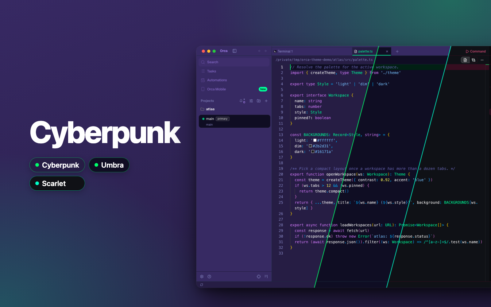
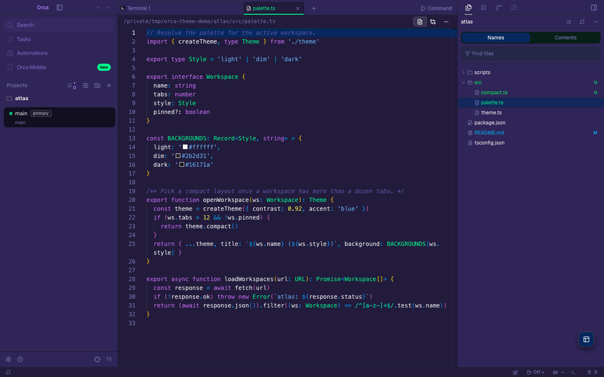
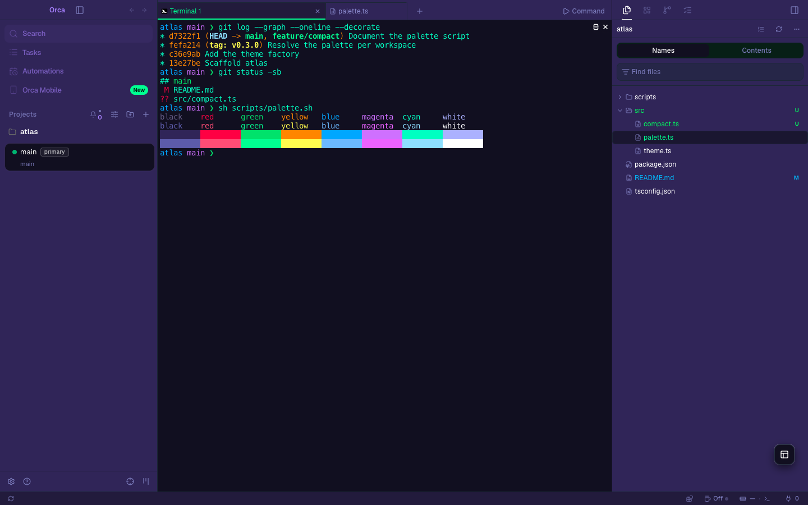
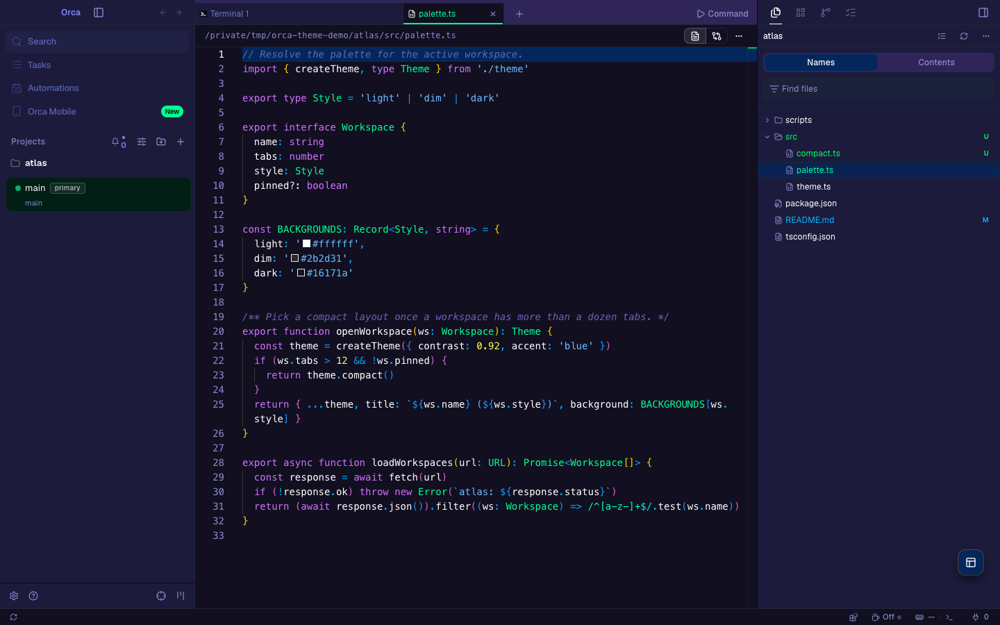
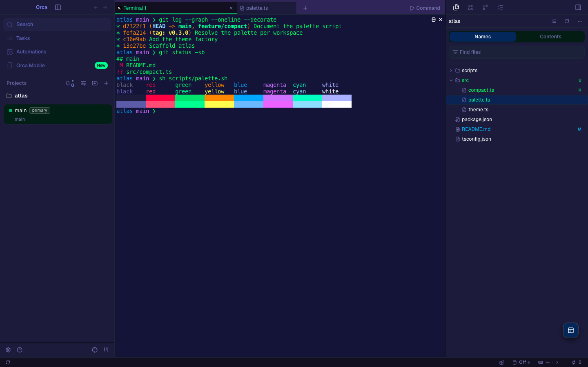
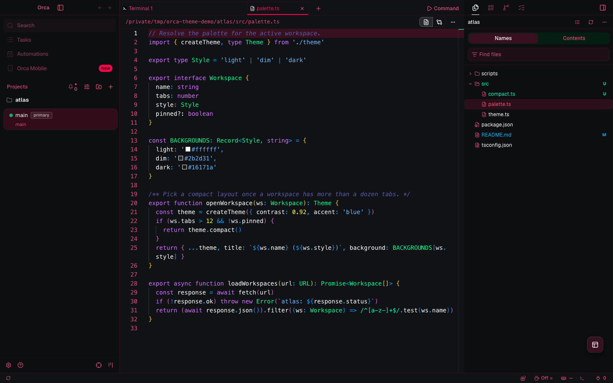
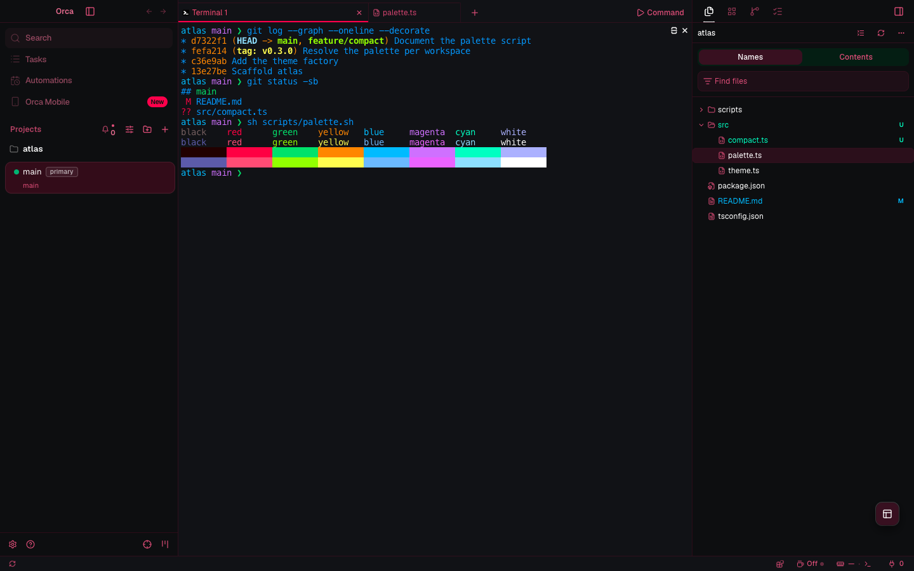

# Cyberpunk for Orca

The three styles of [Cyberpunk](https://github.com/prometheux-ar/cyberpunk) (the VS Code extension
`max-SS.Cyberpunk`) as app, editor and terminal themes for [Orca](https://github.com/stablyai/orca):
Cyberpunk, Cyberpunk Umbra and Cyberpunk Scarlet. They are built from cyberpunk commit
[`632f187`](https://github.com/prometheux-ar/cyberpunk/tree/632f187e343fafc499d89f5ddaa6895ebc10ab94)
(extension version 1.2.14).



## The themes

| Style | Upstream name | Canvas | Accent |
| --- | --- | --- | --- |
| Cyberpunk | Cyberpunk | violet `#261d45` | mint `#00ff9c` |
| Cyberpunk Umbra | Activate UMBRA protocol | near-black indigo `#100d23` | mint `#00ff9c` |
| Cyberpunk Scarlet | Activate SCARLET protocol (beta) | near-black `#101116` | scarlet `#ff0055` |

All three share upstream's neon code colors: violet keywords, blue functions, sky blue strings,
yellow numbers, mint types and pink tags. Each theme also sets the 16 ANSI colors of the terminal.

| Style | Editor | Terminal |
| --- | --- | --- |
| Cyberpunk |  |  |
| Umbra |  |  |
| Scarlet |  |  |

## Install

Find **Cyberpunk for Orca** in Orca's plugin directory and install it. It needs Orca 1.4.255 or later. To
install it from this repository instead:

1. In Orca, open Settings → Plugins.
2. Open **Add plugin** → **From a Git URL…**.
3. Enter `https://github.com/vale-c/orca-cyberpunk.git` with ref `main`, and install
   **Cyberpunk for Orca**.
4. In Settings → Appearance, pick **Cyberpunk**, **Cyberpunk Umbra** or **Cyberpunk Scarlet** as
   the dark theme. Pick the terminal theme of the same name in the terminal settings.

To try a local copy instead, use **Add plugin** → **From a folder…** and select the root folder of
this repository. Orca reloads the themes when the files change.

## How the colors map

`scripts/cyberpunk-palette.json` holds upstream's three VS Code theme files, read the way VS Code
reads them (they have comments and trailing commas). `scripts/build.mjs` maps them to Orca.

Each Orca token takes the VS Code color that paints the same part of the window. For example,
`--background` is `editor.background`, `--sidebar` is `sideBar.background`, `--popover` is
`editorHoverWidget.background`, `--tab-active-indicator` is `panelTitle.activeBorder`, and
`--diff-added-background` is `diffEditor.insertedTextBackground`. Each syntax rule takes the color
and font style that upstream's rules give one named scope. `scripts/build.mjs` lists every
mapping, and `scripts/derived-tokens.json` lists the tokens left to Orca with the reason for each.

Upstream's themes mix their own neon colors with colors left over from the Material Theme and
VS Code Dark+ templates they started from, such as `#c792ea`, `#ffcb6b`, `#f78c6c`, `#ff5370`,
`#82aaff`, `#89ddff`, `#65737e` and `#eeffff`. To keep one palette, the build reads a **core
palette** for each style from upstream's own colors only, by role:

| Role | Upstream source | Cyberpunk | Umbra | Scarlet |
| --- | --- | --- | --- | --- |
| text | `foreground` | `#ffffff` | `#ffffff` | `#ffffff` |
| accent | `editor.foreground` | `#00ff9c` | `#00ff9c` | `#ff0055` |
| comment | `comment` | `#6766b3` | `#6766b3` | `#6766b3` |
| keyword | `keyword` | `#d57bff` | `#d57bff` | `#d57bff` |
| function | `entity.name.function` | `#00b0ff` | `#00b0ff` | `#00b0ff` |
| string | `string` | `#76c1ff` | `#76c1ff` | `#76c1ff` |
| number | `constant.numeric` | `#fffc58` | `#fffc58` | `#fffc58` |
| type | `support.class` | `#00ff9c` | `#00ff9c` | `#00ff9c` |
| tag | `entity.name.tag` | `#ff5680` | `#ff5680` | `#ff5680` |
| attribute | `entity.other.attribute-name` | `#ee6dff` | `#ee6dff` | `#ee6dff` |
| property | `source.css support.type.property-name` | `#98e3ff` | `#98e3ff` | `#98e3ff` |
| blockVariable | `meta.block variable.other` | `#b4baff` | `#b4baff` | `#b4baff` |
| link | `string.other.link` | `#00ff9c` | `#00ff9c` | `#00ff9c` |
| error | `gitDecoration.deletedResourceForeground` | `#ff004c` | `#ff004c` | `#ff004c` |
| success | `gitDecoration.untrackedResourceForeground` | `#00ff6a` | `#00ff6a` | `#00ffc8` |
| info | `gitDecoration.modifiedResourceForeground` | `#00c3ff` | `#00c3ff` | `#00c3ff` |
| warning | `inputValidation.warningBorder` | `#ff9100` | `#ff9100` | `#ff9100` |
| cyan | `editorLineNumber.activeForeground` | `#00ffc8` | `#00ffc8` | `#00ffc8` |
| green | `peekView.border` | `#00e676` | `#00e676` | `#00e676` |
| lime | `terminalCursor.foreground` | `#9dff00` | `#9dff00` | `#9dff00` |
| method | `entity.name.method.js` | `#6095ff` | `#6095ff` | `#6095ff` |
| editorLink | `editorLink.activeForeground` | `#3d81fe` | `#3d81fe` | `#3d81fe` |
| quiet | `panel.background` / `dropdown.background` | `#100d23` | `#131341` | `#002212ec` |
| edge | `titleBar.border` / `editorGroup.border` | `#100d23` | `#1e2c3f` | `#ff00552a` |
| shade | `tab.inactiveBackground` / `sideBar.background` / `sideBarSectionHeader.background` | `#372963` | `#1e1d45` | `#240000` |
| selection | `editor.selectionBackground` / `editor.selectionHighlightBackground` | `#311b92` | `#311b92` | `#ff00552c` |

A leftover color never ships. The rule or token that carries one takes the core color with the
same role. `scripts/curation.json` records each change, and `scripts/core-palette.json` the core
palettes. The three styles share one role structure: errors are the error red, additions the
success green, keywords violet, strings sky blue, functions blue, types mint, numbers yellow and
comments `#6766b3`.

## Differences from upstream

### Leftover colors replaced by a core role

The same rule changes in every style. Only additions differ: Scarlet's success color is its teal.

| Rule | Upstream selector | Upstream | Shipped (Cyberpunk, Umbra, Scarlet) | Role | Why |
| --- | --- | --- | --- | --- | --- |
| Variables | `variable` | `#eeffff` | `#ffffff` | text | Plain names read as text: upstream's own text color is its workbench foreground, which its "Colors" rule also uses. |
| Invalid | `invalid` | `#ff5370` | `#ff004c` | error | Invalid code is an error: upstream's own error red is gitDecoration.deletedResourceForeground. |
| Inserted | `markup.inserted` | `#c3e88d` | `#00ff6a` Cyberpunk, `#00ff6a` Umbra, `#00ffc8` Scarlet | success | Inserted lines are additions: upstream's own color for new files is gitDecoration.untrackedResourceForeground. |
| Deleted | `markup.deleted` | `#ff5370` | `#ff004c` | error | Deleted lines are removals: upstream's own color for deleted files is gitDecoration.deletedResourceForeground. |
| Changed | `markup.changed` | `#c792ea` | `#d57bff` | keyword | Changed lines take upstream's own violet, the keyword color, the hue nearest the Material purple. |
| Regular expressions | `string.regexp` | `#89ddff` | `#00ffc8` | cyan | Regular expressions take upstream's own cyan, editorLineNumber.activeForeground, so they stand apart from the sky blue strings. |
| Escape characters | `constant.character.escape` | `#89ddff` | `#00ffc8` | cyan | Escapes read as part of a string pattern, so they take the same cyan as regular expressions. |
| JSON keys | `source.json meta.structure.dictionary.json support.type.property-name.json` | `#c792ea` | `#d57bff` | keyword | The top-level key color takes upstream's own violet, the hue nearest the Material purple. Orca reads no nested-key selectors, so this is the only key level that ships. |
| Markdown text | `text.html.markdown` | `#eeffff` | `#ffffff` | text | Markdown prose reads as text: upstream's own text color is its workbench foreground. |
| Heading marks | `markup.heading.markdown punctuation.definition.heading.markdown` | `#c3e88d` | `#00ff9c` | type | The # marks take the mint that upstream's own entity.name rule gives the heading text. |
| Inline code | `text.html.markdown markup.inline.raw.markdown` | `#c792ea` | `#d57bff` | keyword | Inline code takes upstream's own violet, the hue nearest the Material purple. |
| Inline code punctuation | `text.html.markdown markup.inline.raw.markdown punctuation.definition.raw.markdown` | `#65737e` | `#6766b3` | comment | Quiet Markdown syntax marks take upstream's own comment color. |
| Italic | `markup.italic` | `#f07178` | `#ff5680` | tag | Emphasis takes upstream's own pink, the tag color, the hue nearest the Material red. |
| Bold | `markup.bold` | `#f07178` | `#ff5680` | tag | Strong emphasis takes the same pink as italic, as upstream gives both one color. |
| Underline | `markup.underline` | `#f78c6c` | `#ff5680` | tag | Underline is emphasis, so it takes the same pink as italic and bold. |
| Link titles | `string.other.link.title.markdown` | `#82aaff` | `#00ff9c` | link | Upstream's own String Link rule colors string.other.link mint. A later Material rule overrode the Markdown link. |
| Link descriptions | `string.other.link.description.title.markdown` | `#c792ea` | `#00ff9c` | link | Link text takes the same link color as link titles. |
| Link references | `constant.other.reference.link.markdown` | `#ffcb6b` | `#fffc58` | number | A link reference is a constant: upstream's own constant color is the yellow of its numbers. |
| Code blocks | `markup.raw.block` | `#c792ea` | `#d57bff` | keyword | Code blocks take the same violet as inline code. |
| Fenced code | `markup.raw.block.fenced.markdown` | `#eeffff` | `#ffffff` | text | Fenced code text reads as text: upstream's own text color is its workbench foreground. |
| Fence punctuation | `punctuation.definition.fenced.markdown` | `#00000050` | `#6766b3` | comment | Quiet Markdown syntax marks take upstream's own comment color. The Material color is translucent black, which is invisible on these canvases. |
| Fence language | `variable.language.fenced.markdown` | `#65737e` | `#6766b3` | comment | Quiet Markdown syntax marks take upstream's own comment color. |
| Separators | `meta.separator` | `#65737e` | `#6766b3` | comment | Quiet Markdown syntax marks take upstream's own comment color. |
| Tables | `markup.table` | `#eeffff` | `#ffffff` | text | Table text reads as text: upstream's own text color is its workbench foreground. |
| Log info | `token.info-token` | `#6796e6` | `#00c3ff` | info | Info takes upstream's own info blue, inputValidation.infoBorder and the modified-file color. |
| Log warnings | `token.warn-token` | `#cd9731` | `#ff9100` | warning | Warnings take upstream's own warning orange, inputValidation.warningBorder. |
| Log errors | `token.error-token` | `#f44747` | `#ff004c` | error | Errors take upstream's own error red, gitDecoration.deletedResourceForeground. |
| Log debug | `token.debug-token` | `#b267e6` | `#d57bff` | keyword | Debug takes upstream's own violet, the hue nearest the Dark+ purple. |

### Other role changes

| Style | Token | Upstream source | Upstream | Shipped | Role | Why |
| --- | --- | --- | --- | --- | --- | --- |
| Cyberpunk | `--text-link` | `textLink.foreground` | `#0084ff` | `#00c3ff` | info | Lightness alone reaches 4.5:1 only outside the sRGB gamut (#0084ff to #33a0ff, a hue shift), so it takes the neighboring info role, gitDecoration.modifiedResourceForeground. |
| Cyberpunk | `--diff-removed` | `gitDecoration.deletedResourceForeground (error)` | `#ff004c` | `#ff5680` | tag | Lightness alone reaches 4.5:1 only outside the sRGB gamut (#ff004c to #ff4f70, a hue shift), so it takes the neighboring tag role, entity.name.tag. |
| Umbra | `--text-link` | `textLink.foreground` | `#3d5afe` | `#00c3ff` | info | Lightness alone reaches 4.5:1 only outside the sRGB gamut (#3d5afe to #4d71ff, a hue shift), so it takes the neighboring info role, gitDecoration.modifiedResourceForeground. |
| Scarlet | `--accent-foreground` | `list.activeSelectionForeground` | `#ff0055` | `#ff5680` | tag | Lightness alone reaches 4.5:1 on the selected row only outside the sRGB gamut (#ff0055 to #ff3467, a hue shift), so it takes the neighboring tag role, entity.name.tag. |
| Scarlet | `--primary` | `button.hoverBackground` | `#00ff9c` | `#ff0055` | accent | Scarlet copies Cyberpunk's mint button colors unchanged. Its own action color is its editor.foreground #ff0055, which it also uses for tab.activeBorder and panelTitle.activeBorder. |

### Terminal colors

Upstream sets the terminal's foreground and cursor, and no ANSI color, so VS Code shows its own
defaults. Each ANSI slot takes the core role that plays its part instead, so all 16 colors are
distinct and come from the style. The terminal background is `panel.background`, where VS Code
draws the terminal, and the selection is the core selection role.

The colored slots (all but black, white, bright black and bright white) must stay at least 0.06
from the terminal foreground in OKLab, the same floor as the fills below, or text in that color
would read as plain output. They must also stay 0.06 from each other, so no two read as one
color. A normal and bright pair of one name (red and bright red, and so on) is exempt, because
by terminal convention the bright color is a lighter version of the same color. The build
assigns the slots in table order, cyan before blue. Each slot takes the first of its roles that
passes, and a fallback role must also read at 4.5:1 on the terminal background:

- Cyberpunk's cyan equals its teal foreground `#00ffc8`, so it takes info `#00c3ff` (9.29:1).
  Its blue, function `#00b0ff`, is then 0.053 from that cyan, so it takes upstream's editor link
  blue `#3d81fe` (5.23:1). Its bright blue, string `#76c1ff`, is 0.055 from the cyan, so it takes
  upstream's method blue `#6095ff` (6.56:1).
- Scarlet's blue, function, is 0.038 from its foreground `#00a2ff`, so it takes info `#00c3ff`
  (9.20:1). Its bright green, type `#00ff9c`, is 0.057 from its cyan `#00ffc8`, so it takes the
  lime of upstream's terminal cursor, `#9dff00` (15.03:1).
- The mint bright green is 0.057 from Cyberpunk's foreground and 0.054 from Umbra's `#00ff6a`,
  so both take the lime `#9dff00` (15.16:1 and 13.98:1).

| Slot | VS Code default | Role | Cyberpunk | Umbra | Scarlet |
| --- | --- | --- | --- | --- | --- |
| black | `#000000` | shade | `#372963` | `#1e1d45` | `#240000` |
| red | `#cd3131` | error | `#ff004c` | `#ff004c` | `#ff004c` |
| green | `#0dbc79` | green | `#00e676` | `#00e676` | `#00e676` |
| yellow | `#e5e510` | warning | `#ff9100` | `#ff9100` | `#ff9100` |
| magenta | `#bc3fbc` | keyword | `#d57bff` | `#d57bff` | `#d57bff` |
| cyan | `#11a8cd` | cyan (Cyberpunk: info) | `#00c3ff` | `#00ffc8` | `#00ffc8` |
| blue | `#2472c8` | function (Cyberpunk: editorLink, Scarlet: info) | `#3d81fe` | `#00b0ff` | `#00c3ff` |
| white | `#e5e5e5` | blockVariable | `#b4baff` | `#b4baff` | `#b4baff` |
| brightBlack | `#666666` | comment | `#6766b3` | `#6766b3` | `#6766b3` |
| brightRed | `#f14c4c` | tag | `#ff5680` | `#ff5680` | `#ff5680` |
| brightGreen | `#23d18b` | type (all three: lime) | `#9dff00` | `#9dff00` | `#9dff00` |
| brightYellow | `#f5f543` | number | `#fffc58` | `#fffc58` | `#fffc58` |
| brightBlue | `#3b8eea` | string (Cyberpunk: method) | `#6095ff` | `#76c1ff` | `#76c1ff` |
| brightMagenta | `#d670d6` | attribute | `#ee6dff` | `#ee6dff` | `#ee6dff` |
| brightCyan | `#29b8db` | property | `#98e3ff` | `#98e3ff` | `#98e3ff` |
| brightWhite | `#e5e5e5` | text | `#ffffff` | `#ffffff` | `#ffffff` |

### Lightness changes

Orca drops an app text color under 4.5:1 contrast with its surface, and a git status color under
3:1 on the sidebar. Orca's chat also paints muted text, links and diff text on its own derived
surfaces, and the build checks those at 4.5:1 too. These colors change in OKLCH lightness only,
keeping chroma and hue, by the smallest step that passes. A translucent upstream color is first
painted onto the surface beneath it, and the Upstream column shows that painted color. No syntax
color needed a change.

| Style | Token | Source | Upstream | Shipped |
| --- | --- | --- | --- | --- |
| Cyberpunk | `--muted-foreground` | `tab.inactiveForeground` | `#7877b3` | `#8585c2` |
| Cyberpunk | `--tab-inactive-foreground` | `tab.inactiveForeground` | `#7877b3` | `#9696d4` |
| Cyberpunk | `--chat-muted-foreground` | `tab.inactiveForeground` | `#7877b3` | `#9998d7` |
| Cyberpunk | `--git-decoration-ignored` | `gitDecoration.ignoredResourceForeground` | `#7641a3` | `#9965ca` |
| Umbra | `--muted-foreground` | `tab.inactiveForeground` | `#7877b3` | `#7e7eba` |
| Umbra | `--tab-inactive-foreground` | `tab.inactiveForeground` | `#7877b3` | `#8484c1` |
| Umbra | `--chat-muted-foreground` | `tab.inactiveForeground` | `#7877b3` | `#8585c2` |
| Umbra | `--diff-removed` | `gitDecoration.deletedResourceForeground (error)` | `#ff004c` | `#ff1d53` |
| Umbra | `--git-decoration-ignored` | `gitDecoration.ignoredResourceForeground` | `#3b5293` | `#516aae` |
| Scarlet | `--muted-foreground` | `tab.inactiveForeground` | `#cf4573` | `#dd527f` |
| Scarlet | `--sidebar-foreground` | `sideBar.foreground` | `#be4e74` | `#cc5b80` |
| Scarlet | `--tab-inactive-foreground` | `tab.inactiveForeground` | `#cf4573` | `#d54a78` |
| Scarlet | `--chat-muted-foreground` | `tab.inactiveForeground` | `#cf4573` | `#e75c87` |
| Scarlet | `--diff-removed` | `gitDecoration.deletedResourceForeground (error)` | `#ff004c` | `#ff2055` |
| Scarlet | `--git-decoration-ignored` | `gitDecoration.ignoredResourceForeground` | `#70243d` | `#94455c` |

Four colors reach their floor only by leaving the sRGB gamut, which would shift their hue. They
take the core color of a neighboring role instead, as the role changes table shows: the links of
Cyberpunk and Umbra take the info blue `#00c3ff`, and Cyberpunk's diff removal hue and Scarlet's
selected row text take the tag pink `#ff5680`.

### Other differences

- `--foreground` is upstream's white workbench `foreground`, not its mint (Scarlet: scarlet)
  `editor.foreground`. Orca uses `--foreground` for the text of chat, settings and menus as well
  as the editor, so the accent stays for buttons, the active tab, selected rows and focus. Code
  keeps upstream's colors because every scope Orca's languages color has a rule.
- Menus and popovers use `editorHoverWidget.background` and the editor text color, the hover
  widget each upstream screenshot shows.
- Secondary text uses `tab.inactiveForeground`, upstream's color for inactive tabs, inactive panel
  titles and peek results. Upstream sets no `descriptionForeground`. Its line number color is not
  used, because Cyberpunk's `#9f5fff` leaves the sRGB gamut before it reaches 4.5:1.
- Hover and selected rows (`--accent`) use `editorSuggestWidget.selectedBackground`, the color
  upstream draws for the selected row of its suggest popover. Orca paints this fill on the canvas,
  in the sidebars and inside the command palette, menus and selects. Upstream's list colors would
  vanish there: in Umbra `list.activeSelectionBackground` equals the hover widget color that
  popovers use, and in Scarlet `list.hoverBackground` equals the canvas. The build fails when
  `--accent` is less than 0.06 from `--background`, `--popover` or `--sidebar` in OKLab. Orca also
  draws the editor's current line with `--accent`, so it takes this color too.
- Quiet fills (`--muted`) use `panel.background` in Cyberpunk and Umbra and `dropdown.background`
  in Scarlet. Upstream's `input.background` equals the hover widget color in Cyberpunk and Umbra,
  so the command palette's input band and pinned rows vanished inside popovers, and Scarlet's
  input color was 0.031 from its canvas. Scarlet's panel is its canvas, so it takes its dropdown
  fill. The build fails when `--muted` is less than 0.06 from `--background` or `--popover`.
  Scarlet's secondary text is lightened to `#dd527f` (was `#d54b78`) to read 4.5:1 on that fill.
- Hairlines (`--border`) use `editorGroup.border` in Umbra and Scarlet and `titleBar.border` in
  Cyberpunk, where the group border `#1e2c3f` is 0.052 from the canvas and idle inputs barely
  showed. The build fails when `--border` is less than 0.06 from `--background`.
- Input borders follow `--border`. Upstream's `input.border` is the full mint accent in Cyberpunk
  and Umbra (Scarlet's is blue `#00a2ff`), which would put a strong color on every idle field. A
  focused field shows the focus ring.
- Markdown links (`markup.underline.link`) take the Underline row's pink, as VS Code colors them
  through upstream's `markup.underline` rule. Upstream lists no rule for the link scope itself.
- The chat and terminal selection take the core selection role. For Cyberpunk and Umbra that is
  `editor.selectionBackground`, as VS Code paints it. Scarlet's `editor.selectionBackground` is
  `#000000`, which barely shows on its `#101116` canvas, so Scarlet takes its own selection
  highlight, `editor.selectionHighlightBackground` (`#ff00552c`, `#390e21` on the canvas).
- Focus rings, the editor cursor and the editor selection use `editorCursor.foreground`. Orca draws
  the cursor and a 30% selection from the ring color. Upstream sets no `focusBorder`.
- The active tab line is `panelTitle.activeBorder`. Cyberpunk and Umbra set no
  `tab.activeBorder`, and Scarlet's is the same color. The split divider turns the accent on hover.
  Upstream sets no `sash.hoverBorder`.
- Upstream sets no git color for added, renamed or copied files. They use upstream's untracked
  color, as VS Code does for renamed files. The diff hues are the success and error roles, because
  upstream sets no diff overview color. The diff tints keep upstream's `diffEditor` colors with
  their alpha.
- Orca requires opaque surfaces, so translucent upstream surfaces (hover widgets, inputs, list
  selection, Scarlet's dropdown fill and selection, the Umbra and Scarlet borders) are painted
  onto the editor canvas. The workspace row and the diff tints keep their alpha, because Orca
  paints them over a surface.
- Orca reads no descendant selectors (`a b`), so a rule that uses only those ships under the plain
  scope it ends with, when one exists: CSS property names, HTML attributes, the top JSON key
  level, Markdown heading marks, inline code and inline code punctuation. The rest of upstream's
  scopes are left out. They fall in these groups: descendant selectors with no plain equivalent
  (nested JSON keys, nested bold and italic, scoped variables, methods and decorators), glob
  scopes (`*url*`), scopes of tools Orca does not run (`markup.*.git_gutter`), misspelled scopes
  that match nothing, scopes a shorter shipped scope already gives the same color
  (`punctuation.definition.tag.*.html` under `punctuation.definition.tag`), and scopes a leftover
  rule spreads onto unrelated code (`punctuation.section.class.end` in the fenced-code rule).
  `SYNTAX` in `scripts/build.mjs` is the full list of what ships.
- Orca's built-in CSS and HTML tokenizers emit `attribute.name` for CSS property names and HTML
  attributes, which Orca colors by `entity.other.attribute-name`, upstream's magenta. The CSS
  property name and HTML attribute rows therefore apply only to plugin grammars that emit those
  scopes. Its JSON tokenizer emits `string.key.json`, which Orca colors by
  `support.type.property-name`, so the JSON keys row also ships that plain scope. Before, JSON
  keys showed mint through `support.type`.
- Upstream's Markdown heading rule writes `markup.heading | markup.heading entity.name` as one
  selector, which VS Code never matches. Heading text is `entity.name.section.markdown`, which
  upstream's `entity.name` rule colors mint, in VS Code and in Orca alike. The `#` marks take the
  same mint (they were sky blue). The sky blue of upstream's String rule stays on `markup.heading`
  for heading parts with no more specific scope.
- Upstream's string and heading rules set the font style `normal`, which VS Code reads as no
  style. Orca writes that as `""`. Upstream's `strike` font style for `markup.strike` is not an
  Orca style, and the rule sets no color, so it is left out.
- Umbra colors `keyword.other` and units yellow, Cyberpunk and Scarlet pink. Both are upstream's
  own colors, so each style keeps its own.

## Build and verify

The files in `themes`, `terminal`, `scripts/core-palette.json`, `scripts/curation.json` and
`scripts/deviations.json` are generated. Do not edit them by hand. Change `scripts/build.mjs` and
rebuild instead.

```sh
node scripts/build.mjs           # regenerate the theme files from scripts/cyberpunk-palette.json
node scripts/build.mjs --check   # exit 1 if a committed file is out of date
```

The build fails when an app token pair is under Orca's contrast floor, or when a leftover color
reaches a rule that names no role for it. It prints every color it changed in OKLCH lightness.

To move to a newer upstream commit, change `COMMIT` in `scripts/vendor-palette.mjs`, check out that
commit in a cyberpunk clone, run `node scripts/vendor-palette.mjs /path/to/cyberpunk`, then rebuild.

To check the themes with Orca's own runtime code, point `ORCA_DIR` at an Orca checkout with its
dependencies installed (`pnpm install`, then `pnpm run build:packages`):

```sh
ORCA_DIR=/path/to/orca node scripts/verify.mjs
ORCA_DIR=/path/to/orca node scripts/coverage.mjs
cd /path/to/orca && pnpm validate:plugin /path/to/orca-cyberpunk
```

`verify.mjs` fails when Orca would drop a theme token or a syntax color, or reject a terminal
theme, and checks every row of `scripts/deviations.json`. `coverage.mjs` fails when a public Orca
token is neither set nor listed in `scripts/derived-tokens.json`.

`scripts/theme.spec.ts` drives a real Orca build. It loads the plugin, selects each theme, checks
the applied app tokens and editor token colors, and saves an editor and a terminal screenshot. It
opens a small demo project, `atlas`, under `/tmp/orca-theme-demo`, and deletes it afterwards. Copy
the spec into the Orca checkout's `tests/e2e/` and run:

```sh
ORCA_THEME_PLUGIN_DIR=/path/to/orca-cyberpunk ORCA_THEME_SHOTS_DIR=/tmp/shots \
  npx playwright test tests/e2e/theme.spec.ts --config tests/playwright.config.ts --project=electron-headless
```

`ORCA_DIR=/path/to/orca node scripts/cover.mjs . /tmp/shots` then composes `images/cover.png` from
the screenshots.

## Release

Orca's plugin directory lists the newest `vX.Y.Z` tag. To release a change:

1. Bump `version` in `orca-plugin.json` and commit.
2. Run `ORCA_DIR=/path/to/orca node scripts/catalog-entry.mjs .`. It adds the validator's release
   entry for that commit to `orca-catalog.json`.
3. Run the Orca validator on this folder again, and commit `orca-catalog.json` alone.
4. Push the commit and the tag: `git tag vX.Y.Z && git push origin main vX.Y.Z`.

`orca-catalog.json` is what **From a Git URL…** reads.

## License

GPL-3.0, the license in upstream's `LICENSE` file. Upstream's `package.json` says MIT, but the
license file it ships is the GPL, so this plugin follows the file. See [LICENSE](LICENSE).
Cyberpunk is by [max-SS](https://github.com/prometheux-ar).
